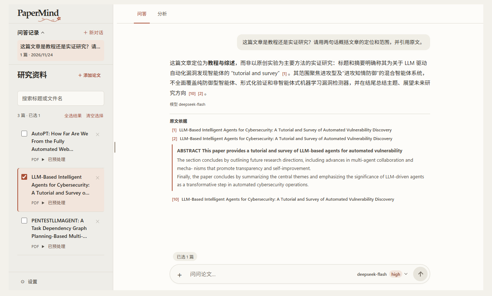
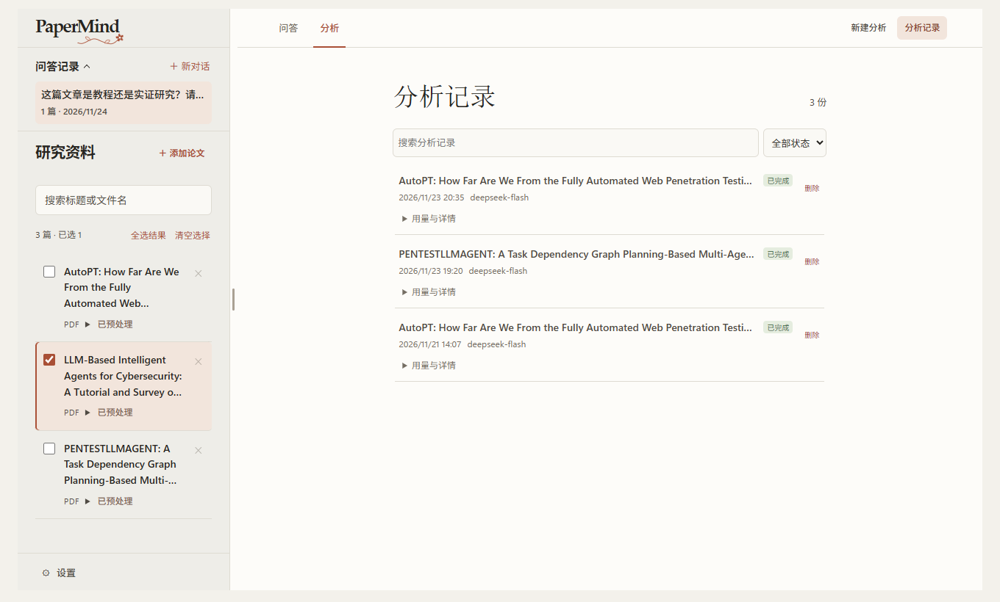
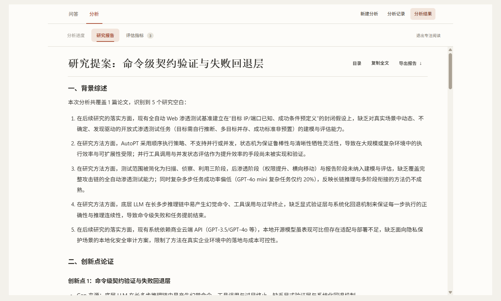
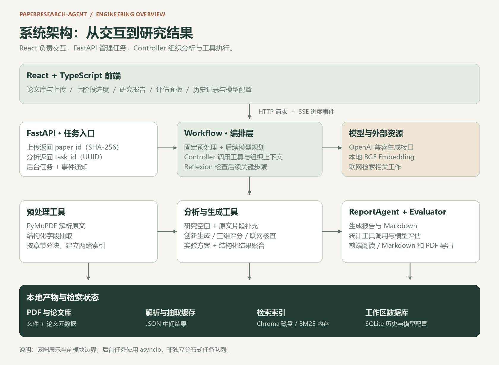
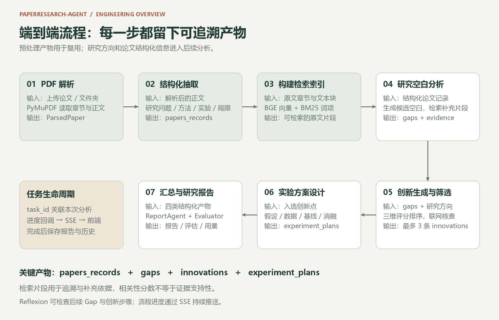
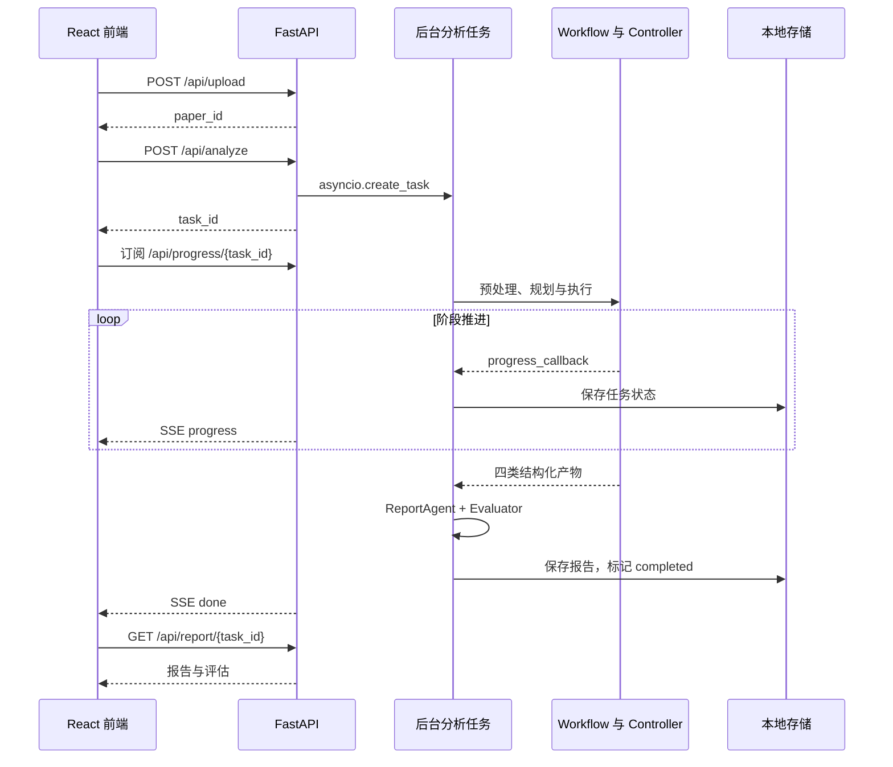

<div align="center">

# PaperResearch-Agent

### 论文科研智能体 · 从文献阅读到研究提案

批量解析论文，抽取研究结构，检索原文线索，生成候选研究空白、创新方向与实验方案。


[界面预览](#界面预览) · [整体架构](#整体架构) · [端到端流程](#端到端流程) · [关键工程设计](#关键工程设计) · [本地运行](#本地运行)

</div>

## 项目解决什么问题

阅读多篇论文时，研究问题、方法、实验设置和局限性分散在不同章节，人工整理后还需要进一步比较与验证。这个项目把这些工作组织为一个有中间产物、进度反馈和结果追溯的分析流程。

用户上传或选择 PDF，指定研究方向后，系统输出研究提案：**背景综述、候选研究空白、创新点、实验方案及参考信息**。交互侧提供论文库、阶段进度、模型配置、历史报告、逐项评估与导出。

| 核心能力 | 实现方式 |
| --- | --- |
| 批量论文预处理 | PyMuPDF 解析，结构化抽取，并发限制与独立缓存 |
| 原文检索 | 本地 BGE Embedding、Chroma 向量检索、BM25 词面检索 |
| 分阶段研究构思 | Controller 组织计划与上下文，专用工具生成空白、创新点和实验方案 |
| 过程检查 | 后续关键步骤的 Reflexion 检查、有限重试与复核标记 |
| 任务可观测 | SSE 进度事件、工具调用记录、模型用量与费用估算 |
| 结果管理 | SQLite 分析历史、Markdown 阅读、Markdown 与 PDF 导出 |

## 问答与分析工作台

- **论文问答**：选定一篇或多篇论文提问，回答附原文引用，可在侧栏查看历史对话。
- **研究分析**：从分析记录打开或追踪任务，完成后直接阅读报告，可复制全文或导出 Markdown、PDF。
- **模型与推理强度**：在问答和新建分析的模型菜单选择模型。受支持的 DeepSeek 模型提供 low、high、max 三档。

## 界面预览

### 论文问答

选定一篇公开论文提问，点开引用可查看出处和原文片段。



### 分析记录

从历史列表查看任务状态，打开已完成的分析报告。



### 研究报告

标题下方直接进入正文。目录、复制和导出集中在报告顶部。



## 整体架构

系统由 **交互层、任务接口层、编排层、工具与检索层、模型接口层、本地存储层**组成。



| 模块 | 主要职责 | 源码入口 |
| --- | --- | --- |
| React 工作台 | 上传、论文选择、进度订阅、报告阅读与历史切换 | [`App.tsx`](frontend/src/App.tsx) |
| FastAPI 接口 | 在本地启动分析任务，通过 SSE 推送进度，读取报告与论文库 | [`routes.py`](backend/api/routes.py) |
| TaskManager | 管理本次任务状态、事件通知与持久化更新 | [`tasks.py`](backend/api/tasks.py) |
| WorkflowOrchestrator | 组合 Controller 与后续步骤自校验，聚合结构化产物 | [`workflow.py`](backend/orchestrator/workflow.py) |
| Controller | 固定预处理、生成后续计划、调度工具、组织上下文 | [`controller.py`](backend/orchestrator/controller.py) |
| ToolRegistry / ToolLoop | 工具 schema、函数注册与模型工具调用循环 | [`base.py`](backend/tools/base.py) · [`function_calling.py`](backend/llm/function_calling.py) |
| HybridSearcher | 原文分块、向量与 BM25 召回、分数融合 | [`hybrid_search.py`](backend/rag/hybrid_search.py) |
| ReportAgent / Evaluator | 生成报告、评价创新点并汇总调用统计 | [`report_agent.py`](backend/agents/report_agent.py) · [`evaluator.py`](backend/evaluator/evaluator.py) |
| Workspace Storage | SQLite 历史、模型配置与密钥保护 | [`workspace.py`](backend/storage/workspace.py) |

**执行方式是混合编排。** 解析、抽取、索引按固定预处理执行；模型提出后续计划，Controller 实际执行。关键分析阶段直接调用对应工具以确保参数传递，专职 Agent 执行路径保留 Function Calling 工具循环。后续主流程按计划顺序运行，论文级预处理使用有界并发。

## 端到端流程



| 阶段 | 输入 | 处理 | 主要产物 |
| --- | --- | --- | --- |
| 1. PDF 解析 | 已上传文件或文件夹路径 | 读取正文、章节和标题，复用有效解析缓存 | `ParsedPaper` |
| 2. 结构化抽取 | 解析正文 | 模型抽取研究问题、方法、数据集、指标、结果、局限及未来工作 | `papers_records` |
| 3. 索引构建 | 原文章节 | 按章节与段落分块，生成向量，写入 Chroma 与 BM25 | 原文片段与检索索引 |
| 4. 研究空白分析 | 多篇结构化记录 | 按维度比较，生成候选空白，再检索补充原文片段 | `gaps`，含 `evidence` |
| 5. 创新生成 | 候选空白与研究方向 | 生成思路，三维评分求和排序，保留最多三条并联网核查 | `innovations` |
| 6. 实验设计 | 入选创新点 | 生成假设、数据集、基线、指标、消融、步骤和风险 | `experiment_plans` |
| 7. 汇总与报告 | 上述结构化产物 | 工作流聚合结果，ReportAgent 生成报告，Evaluator 补充评估 | `markdown`、`report`、`evaluation` |

工作流聚合后的四类核心输入为：

```text
papers_records     论文研究结构与来源字段
gaps               候选研究空白与原文片段
innovations        创新点、评分与联网核查结果
experiment_plans   假设、对照、指标与实验步骤
```

### 一次请求如何贯穿全流程



## 关键工程设计

### 1. 将文件身份与任务身份分开

`paper_id` 是 PDF 文件字节的 SHA-256，同一文件改名后仍可识别；`task_id` 是每次分析独立生成的 UUID。同一论文可多次分析，任务的模型、研究方向、进度和报告分别记录。

论文级解析与抽取产物写入独立缓存，减少重复预处理。缓存复用条件与完整分析结果缓存是两件事；当前没有把所有输入版本统一纳入一个完整的分析缓存键。

### 2. 通过混合检索补充原文细节

向量召回处理语义相近、措辞不同的表达；BM25 补充方法名、缩写和数据集名称的词面匹配。当前实现两路各召回 `2 × top_k` 个候选，分别做 min-max 归一化，以文本合并后加权排序：

```text
score = 0.6 × normalized_vector_score
      + 0.4 × normalized_bm25_score
```

Chroma 保存向量与片段元数据，BM25 使用进程内索引。权重是当前配置，尚未通过独立标注集证明最优。原文片段用于补充和追溯出处，目前尚未逐条核验它们是否支持候选研究空白。

### 3. 并发放在论文级，阶段之间保留数据依赖

预处理采用 `asyncio.gather` 与 `Semaphore` 控制论文级并发，单篇失败不直接丢弃其他成功结果。解析或抽取完全失败时，明确终止报告生成，避免以空记录生成看似成功的报告。

阶段间通过结构化结果传递信息，便于定位问题出在解析、抽取、检索还是后续生成。当前计划规范化与调度不等于完整的 DAG 校验或通用并行调度器。

### 4. 用事件通知展示长任务进度

分析接口先返回 `task_id`，后台执行任务。进度回调更新任务并追加事件，SSE 消费增量事件；`asyncio.Event` 唤醒等待，减少无意义轮询。

任务摘要和最终结果持久化到 SQLite，前端可重新打开历史报告。服务重启后的未完成任务会提示中断，不把旧的 `running` 状态当作仍在执行；当前尚不支持从任意分析阶段自动恢复。

### 5. 检查生成结果，同时保留可观测信息

结构化抽取包含字段值、来源章节和置信度信息，并对模型 JSON 进行解析与规范化。后续 Gap、创新等关键步骤可触发 Reflexion 检查与有限重试；仍不达标时保留复核信息。

工具记录包含名称、参数摘要、成功状态、耗时和错误信息。模型客户端记录 token 用量，按可用费率或服务返回费用展示估算及来源，便于分析一次任务的效果、延迟和成本。

## 接口概览

| 方法 | 路径 | 用途 |
| --- | --- | --- |
| `POST` | `/api/upload` | 上传 PDF，返回 `paper_id` |
| `GET` | `/api/papers` | 读取论文库与预处理状态 |
| `POST` | `/api/analyze` | 提交论文 ID 或文件夹，以及可选研究方向 |
| `GET` | `/api/progress/{task_id}` | SSE 订阅进度 |
| `GET` | `/api/tasks/{task_id}` | 查询任务状态 |
| `GET` | `/api/report/{task_id}` | 获取报告与评估 |
| `GET` | `/api/report/{task_id}/pdf` | 下载 PDF 报告 |
| `GET` | `/api/history` | 读取分析历史 |
| `GET / PUT` | `/api/model-settings` | 读取或更新模型配置 |
| `GET` | `/api/qa/conversations` | 列出论文问答对话 |
| `POST` | `/api/qa/conversations/{id}/turns` | 向所选论文提问并保存对话 |

完整接口文档：启动后访问 `http://127.0.0.1:8000/docs`。

## 本地运行

推荐 **Python 3.12、Node.js 20+**。当前密钥加密保存使用 Windows DPAPI，Windows 是本项目已使用的运行环境。

### 1. 安装后端依赖

```powershell
git clone https://github.com/shen0115/PaperResearch-Agent.git
cd PaperResearch-Agent
python -m venv .venv
.venv\Scripts\Activate.ps1
python -m pip install -r backend/requirements.txt
Copy-Item .env.example .env
```

### 2. 配置模型

在本机的 `.env` 中填写 API Key，并配置 Embedding 模型。

```dotenv
DEEPSEEK_API_KEY=
DEEPSEEK_BASE_URL=https://api.deepseek.com
DEEPSEEK_MODEL=deepseek-chat
EMBEDDING_MODEL=BAAI/bge-large-zh-v1.5
```

Embedding 加载器使用本地优先、离线模式，需要提前下载模型到 Hugging Face 缓存，或把 `EMBEDDING_MODEL` 改为完整的本地模型目录。当前向量实现通过 `transformers` 加载 BGE 系列模型，并在 CUDA 可用时使用 GPU，否则使用 CPU。

生成模型也可通过侧栏「设置」配置兼容接口，并执行抽取兼容性检查。非 Windows 环境应通过 `.env` 提供凭据，不依赖 Windows 专用的密钥保存功能。

### 3. 启动服务

后端终端：

```powershell
python run_backend.py
```

另开前端终端：

```bash
cd frontend
npm ci
npm run dev
```

打开前端终端显示的地址，上传或选择论文，填写研究方向后启动分析。Embedding 预加载与首次初始化可能较慢，启动进度可在后端日志查看。

### 4. 构建检查

```bash
cd frontend
npm run build
```

本次发布已完成前端生产构建、Python 源文件语法检查，以及使用真实历史数据的界面截图检查。检索效果和研究空白准确率尚未形成独立基准评测，不在此给出未经测量的提升比例。

## 代码导航

```text
backend/
├── api/              FastAPI 路由 模型设置 任务状态与事件
├── orchestrator/     Controller Workflow Reflexion
├── agents/           专职 Agent 与 ReportAgent
├── tools/            解析 抽取 检索 空白 创新与实验设计
├── rag/              分块 BGE Chroma BM25 与融合检索
├── llm/              兼容模型调用 工具循环 用量与费用
├── models/           结构化数据模型
├── storage/          SQLite 论文库与报告导出
├── memory/           会话与长期记忆组件
└── evaluator/        模型评分 工具统计与结果汇总
frontend/
└── src/              工作台 论文库 阶段卡片 报告与评估组件
docs/assets/          界面示例截图 架构图与流程图
.env.example          空白凭据配置样例
run_backend.py        后端启动入口
```
